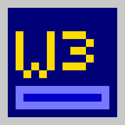

<h1 align="center">Wolf3D for Linux</h1>

<p align="center">
  
</p>

<p align="center">
  Motor propio de <b>Wolfenstein 3D</b> escrito desde cero en C con SDL2,<br>
  que lee los archivos originales del juego.
</p>

<p align="center">
  
  
  
  <a href="https://github.com/CarlOS-Creator109/Wofl3D-for-linux/releases/latest">
    
  </a>
</p>

<p align="center">
  <b><a href="https://github.com/CarlOS-Creator109/Wofl3D-for-linux/releases/latest">Descargar el AppImage</a></b> &nbsp;·&nbsp;
  un solo archivo, sin compilar nada
</p>

---

> **Este repositorio no incluye los archivos del juego.** Wolfenstein 3D es
> propiedad de id Software / ZeniMax. Necesitas tu propia copia del juego.

## Qué es esto

Un port de Wolfenstein 3D a Linux moderno, pero no un recompilado del código
original: el motor está escrito desde cero. Lo que sí viene del código fuente
que id Software liberó bajo GPLv2 son las tablas y la lógica de juego (estados
de los enemigos, fórmulas de daño, velocidades, tiempos par), para que se
comporte igual que el original y no "parecido".

Hecho por **COS-Mods**. Desarrollado y probado en una Sony Vaio VPCEE22FX
(AMD Turion II, 2010) con Arch Linux.

## Capturas

<!-- Pon tus capturas en una carpeta capturas/ y descomenta estas líneas:
<p align="center">
  
  
</p>
<p align="center">
  
  
</p>
-->

## Instalación

**Opción 1 — compilar** (recomendada):

```sh
sudo pacman -S sdl2              # Arch
# sudo apt install libsdl2-dev   # Debian / Ubuntu

make
mkdir datos                      # pon aquí tus archivos del juego
./wolf datos
```

**Opción 2 — AppImage** (un solo archivo, sin compilar):

```sh
./build-appimage.sh
./Wolf3D-x86_64.AppImage datos
```

**Opción 3 — el binario incluido:** el ejecutable `wolf` del repositorio está
compilado en Arch Linux. En otras distros puede no arrancar por las versiones
de las bibliotecas; ahí usa las opciones 1 o 2.

### Archivos que necesitas

`MAPHEAD`, `GAMEMAPS`, `VSWAP`, `VGAGRAPH`, `VGAHEAD`, `VGADICT`, `AUDIOHED`
y `AUDIOT`, con extensión `.WL6` (versión completa), `.WL1` (shareware),
`.SOD` o `.SDM`. Mayúsculas o minúsculas, da igual.

## Controles

| Tecla | Acción |
|---|---|
| Ratón | Girar la vista |
| `W` `S` | Avanzar y retroceder |
| `A` `D` | Moverse de lado |
| `Shift` | Correr |
| Clic izquierdo / `Ctrl` | Disparar |
| Clic derecho / `Espacio` / `E` | Usar puertas, elevadores y muros secretos |
| `1` `2` `3` `4` | Cuchillo, pistola, ametralladora, gatling |
| `Esc` | Menú |
| `Tab` | Soltar o capturar el ratón |
| `PgUp` `PgDn` | Cambiar de piso |

### Opciones de línea de comandos

```
-m N        empezar en el piso N (0..59 en WL6, 0..9 en WL1)
-s N        dificultad: 0 bebé, 1 fácil, 2 normal, 3 muerte (por defecto 1)
--sens 0.2  sensibilidad del ratón (grados por cuenta, por defecto 0.12)
--nosound   arrancar sin audio
```

Las partidas se guardan como `wolfsave0.sav` … `wolfsave5.sav` en la carpeta
desde donde corres el juego.

## Qué funciona

**Gráficos**
- Mapas con descompresión Carmack + RLEW, texturas y sprites de `VSWAP`,
  gráficos de `VGAGRAPH` (Huffman + planos VGA).
- Paleta VGA original, vista de 320×200 con píxeles 6:5, mismo campo de visión
  y misma proyección que el original.
- Paredes, puertas deslizables (normales, con llave, de elevador) y muros
  empujables.

**Juego**
- Enemigos con la máquina de estados completa: guardias, perros, SS, oficiales,
  mutantes, Hans, Gretel, Schabbs, Fake Hitler, Mecha Hitler, Gift, Fat y los
  fantasmas. Patrullan, te ven, te persiguen, esquivan, disparan y mueren.
- Combate con las fórmulas del original: puntería según la distancia y si vas
  corriendo, daño por cercanía, daño doble a enemigos desprevenidos.
- Cuatro armas con sus cuadros y cadencias; vida, munición, puntaje, vidas,
  llaves, tesoros y conteo de secretos.
- Barra de estado original con la cara de BJ.
- El elevador secreto lleva al piso 10 y regresa al que le toca a cada episodio.

**Sonido**
- Efectos AdLib originales de `AUDIOT`, con el chip OPL2 emulado.
- Música IMF de cada piso, con la tabla de canciones del original.

**Interfaz**
- Menú con la fuente del juego: continuar, nueva partida (episodio y
  dificultad), guardar y cargar en 6 ranuras, apagar efectos o música.
- Pantalla de estadísticas al terminar cada piso: tiempo contra el par del
  nivel, bonus que sube con su sonido, y porcentajes de muertes, secretos y
  tesoros (10 000 puntos por cada 100 %). Pantalla de fin de episodio al
  derrotar al jefe.

## Qué falta

- La secuencia narrada del final del juego y la tabla de puntajes altos.
- Los sonidos digitalizados de `VSWAP`: el código liberado deja su tabla vacía,
  así que no hay forma fiable de saber qué sonido es cuál. Se usa la versión
  AdLib, que es la que suena en una tarjeta AdLib real.
- Los proyectiles de los jefes funcionan, pero con una versión simplificada.

## Cómo está hecho

| Archivo | Qué hace |
|---|---|
| `wolf.c` | El motor: carga de datos, raycasting, sprites, IA, combate, HUD, menús, guardado |
| `wolfdata.h` | Tablas generadas del código de id: 303 estados de enemigos, sprites, vida por dificultad, tabla de aleatorios |
| `sound.c` | Efectos AdLib y música IMF sobre el OPL2 |
| `opl3.c` | Nuked OPL3, el emulador del chip de sonido |
| `pal.h` | La paleta VGA de 256 colores del juego |

El renderizador usa DDA para lanzar un rayo por columna de pantalla, igual que
el original, y las constantes de proyección salen de `WL_MAIN.C`. La tabla de
aleatorios es la misma de `ID_US_A.ASM`, así que los disparos siguen la misma
secuencia que el juego de verdad.

## Licencia

GPLv2, ver [`COPYING`](COPYING). El motor es propio, pero las tablas y la
lógica de juego vienen del código fuente que id Software liberó bajo esa misma
licencia. `opl3.c` y `opl3.h` son [Nuked OPL3](https://github.com/nukeykt/Nuked-OPL3)
de Nuke.YKT, bajo LGPL 2.1.

Wolfenstein 3D es marca registrada y propiedad de id Software / ZeniMax. Este
proyecto no distribuye ningún dato del juego.
